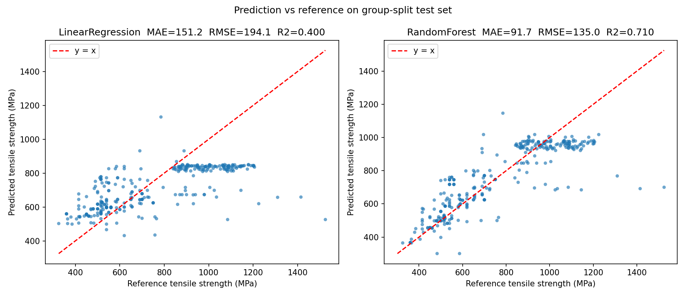
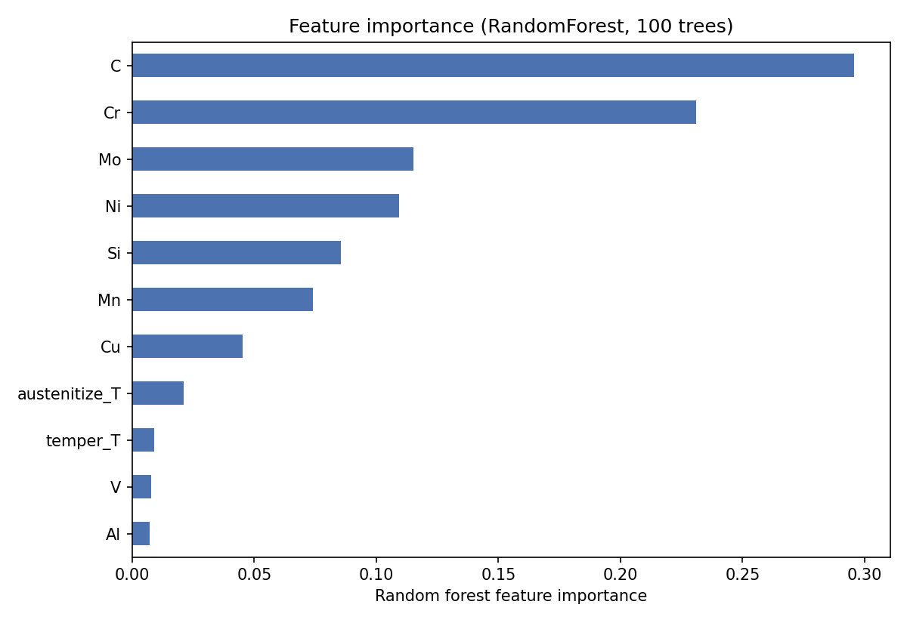

# 合金钢抗拉强度机器学习预测（steel-strength-prediction）

《人工智能与大数据》课堂实践作业：基于 SteelBench v1.0 公开数据，用化学成分与热处理工艺预测钢材抗拉强度，并用 GitHub 管理代码版本。

## 一、数据来源与许可

| 项目 | 内容 |
| --- | --- |
| 数据集 | SteelBench v1.0（`steelbench_core_open.csv`） |
| 作者/维护方 | SteelBench Team |
| DOI | [10.5281/zenodo.18530558](https://doi.org/10.5281/zenodo.18530558) |
| 来源 | https://zenodo.org/records/18530558 |
| 许可 | CC-BY 4.0（Creative Commons Attribution 4.0 International），见 `data/LICENSE` |
| 数据说明 | `data/DATASET_CARD.md` |

原始 CSV 共 **1,360 条记录、25 个字段、562 个钢种**（与数据卡片一致）。原始文件放在 `data/` 目录内，**未做任何修改，也未补造数据**。

`data_tier` 字段区分数据来源性质，本数据中的分布为：

| data_tier | 行数 | 含义 |
| --- | ---: | --- |
| `emk_spec_verified` | 753 | EMK 手册的**技术规范最低值**（不是实测值） |
| `nims_measured` | 360 | NIMS（日本）**实测**数据 |
| `kaggle_measured` | 247 | Kaggle **实测**数据 |

实测数据合计 607 条，规范最低值 753 条，两者在建模时**不做等价处理**，并在误差评估时按来源分别统计。

## 二、输入与输出

**输入特征（11 个）**

- 化学成分（wt.%）：C、Mn、Si、Cr、Ni、Mo、V、Cu、Al
- 热处理工艺（°C）：`austenitize_T`（奥氏体化温度）、`temper_T`（回火温度）

**预测目标**

- `tensile_strength`（抗拉强度，MPa）

其他力学性能（屈服强度、延伸率、硬度等）、钢种编号 `grade_id`、数据来源 `source` **均不作为输入特征**，避免信息泄漏。

**输出文件（`results/`）**

| 文件 | 内容 |
| --- | --- |
| `metrics.csv` | 两个模型在测试集及分数据来源的 MAE、RMSE、R² |
| `predictions.csv` | 测试集样本编号、来源、参考强度与两个模型的预测强度 |
| `prediction_comparison.png` | 参考值 vs 预测值散点图（含 y = x 参考线） |
| `feature_importance.png` | 随机森林特征重要性 |

## 三、运行方法

复用上一次实验的 Python 虚拟环境（不新建环境），在项目根目录执行：

```powershell
C:\Users\26734\anaconda3\envs\random-data\python.exe -m pip install -r requirements.txt
C:\Users\26734\anaconda3\envs\random-data\python.exe steel_regression.py
```

程序使用相对路径读取 `data/`、写出 `results/`，可在任意目录层级运行。

## 四、数据处理与划分方式

1. **清洗**：检查列名、样本量、缺失与重复；剔除目标缺失/非正、`grade_id` 缺失以及完全重复的记录（本数据清洗前后均为 1360 条，无删除）。
2. **划分**：`GroupShuffleSplit`，按 `grade_id` 分组，`test_size=0.2`，`random_state=42`。训练集 1,046 条 / 449 个钢种，测试集 314 条 / 113 个钢种，两组钢种**重叠数为 0**（已断言检查）。
3. **缺失处理**：在 `Pipeline` 中先用 `SimpleImputer(strategy="median", add_indicator=True)`，**只在训练集拟合**中位数；测试集只做变换。未知成分与未知温度**不填 0**（0 在成分/温度上有物理含义，会造成错误信息），而是用训练集中位数填补并附加缺失指示变量。原始 1360 条数据中缺失情况为：`Al` 783 条（57.6%）、`temper_T` 972 条（71.5%）、`austenitize_T` 672 条（49.4%）、`Cu` 578 条（42.5%）、`Mo` 396 条（29.1%）、`Ni` 258 条（19.0%）、`Si` 191 条（14.0%）、`Cr` 181 条（13.3%）；所有候选特征在训练集中均存在有效值，**没有整列完全缺失的列**，因此未剔除任何特征。
4. **模型**：多元线性回归与随机森林回归（`n_estimators=100`, `random_state=42`），使用同一划分、只用训练集训练，**未在测试集上调参**。

## 五、测试结果（真实运行结果）

| 模型 | 样本数 | MAE (MPa) | RMSE (MPa) | R² |
| --- | ---: | ---: | ---: | ---: |
| 多元线性回归 | 314 | 151.20 | 194.06 | 0.4003 |
| 随机森林回归 | 314 | **91.74** | **135.02** | **0.7097** |

分数据来源的误差（测试集）：

| 模型 | data_tier | 样本数 | MAE (MPa) | RMSE (MPa) | R² |
| --- | --- | ---: | ---: | ---: | ---: |
| 线性回归 | emk_spec_verified | 137 | 118.42 | 143.82 | -0.1719 |
| 线性回归 | kaggle_measured | 60 | 174.85 | 262.09 | -0.0515 |
| 线性回归 | nims_measured | 117 | 177.44 | 204.03 | -2.9821 |
| 随机森林 | emk_spec_verified | 137 | 66.94 | 97.36 | 0.4629 |
| 随机森林 | kaggle_measured | 60 | 141.02 | 219.36 | 0.2634 |
| 随机森林 | nims_measured | 117 | 95.51 | 114.67 | -0.2580 |





## 六、结果讨论

**1. 哪个模型误差更小？**
随机森林误差明显更小：MAE 91.74 MPa 比线性回归的 151.20 MPa 低约 39%，RMSE 135.02 比 194.06 低约 30%，全局 R² 从 0.4003 提升到 0.7097。原因是抗拉强度与成分、工艺之间多为非线性关系（例如 C、Cr、Mo 的强化作用存在阈值与交互），树模型能拟合这类分段与交互效应；线性回归只能给出全局线性近似，在高强度区明显低估、在低强度区偏高。

**2. 成分和工艺信息如何用于预测？**
C、Cr、Mo、Ni 等元素通过固溶强化、析出强化和相变影响强度，是主要的输入信号；奥氏体化温度与回火温度决定组织状态（马氏体/贝氏体比例、回火软化程度），因此也被纳入特征。随机森林的特征重要性排序为 C(0.296) > Cr(0.231) > Mo(0.115) > Ni(0.109) > Si(0.085) > Mn(0.074) > Cu(0.045) > austenitize_T(0.021) > temper_T(0.009) > V(0.008) > Al(0.007)。

**3. 缺失工艺与混合来源数据的局限**
- `temper_T` 缺失 71.5%（972/1360）、`austenitize_T` 缺失 49.4%（672/1360）、`Al` 缺失 57.6%（783/1360），大量样本的工艺信息实际不可用；中位数填补只能保证流程正确，不能恢复真实工艺，且会削弱工艺特征的区分能力（这也是 `temper_T` 重要性偏低的原因之一）。
- 数据混合了 **753 条技术规范最低值** 与 **607 条实测值**：前者系统性偏低（是合格下限而非真实性能），与实测数据存在分布偏移，模型会把两类样本混在一起学习，导致跨来源评估不稳定——例如随机森林在 `nims_measured` 子集上 R² 为 -0.258，说明钢种分组划分后跨钢种泛化仍然吃力。
- 数据只有成分与热处理，**没有晶粒度、相比例等组织特征**，也没有尺寸、冷却速率等工艺细节，模型上限受数据本身限制。本结果只能用于课程练习，不能替代实物力学试验。

**4. 特征重要性不等同于因果关系**
随机森林的特征重要性反映的是"该特征在树分裂中降低不纯度的贡献"，受特征量纲、缺失指示变量、特征间相关性影响。C 重要性最高只说明它在本次数据与划分下最有预测贡献，**不等于**"增加碳含量就必然提高抗拉强度"的冶金因果结论；真正的因果判断需要控制实验或冶金机理分析。

## 七、重要声明

- 本项目的训练/测试划分是按 `grade_id` 重新分组划分的**自建划分**，与 SteelBench 官方基准协议（RandomKFold / GKF-grade / LOFO-family / LOSO-source）**不同**，因此本文的 MAE、RMSE、R² **不能与论文报告的基准指标直接比较**，也不构成官方基准测试结果。
- 仓库内不含密码、Token、密钥、虚拟环境或无关文件；姓名学号不在仓库中存放，随课程平台提交。
